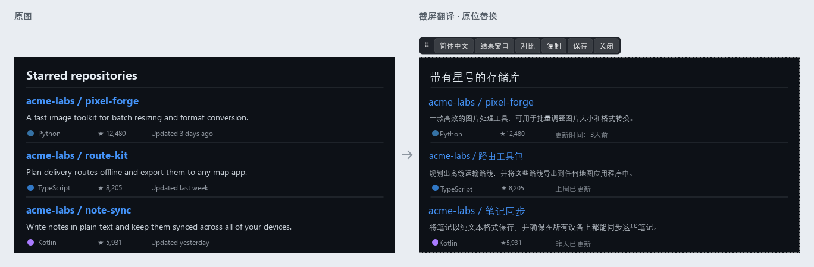
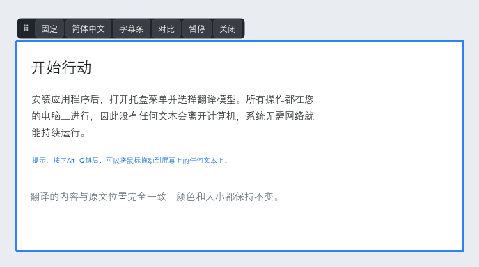
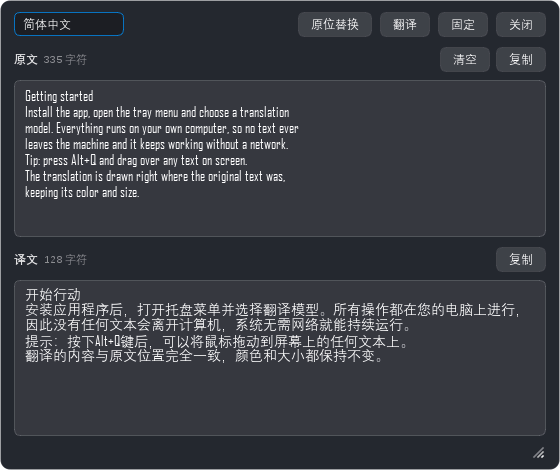
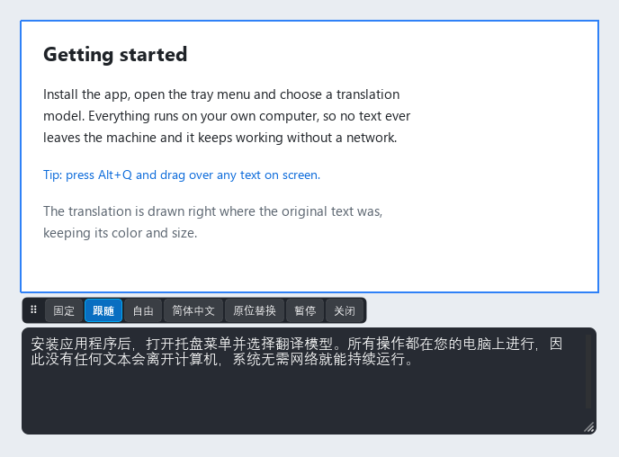

# LocalScreen Translator

A local, offline Windows tray app for screenshot, selected-text, window live, and region live translation. Text recognition and translation run entirely on your PC, with no network needed. Translations can be drawn **in place** over the original text, keeping its color and size, similar to the screenshot translator in Microsoft PC Manager. The UI is available in Chinese and English. [中文说明](./README.md)



> All example images on this page were produced by the local PP-OCRv6 recognizer and the HY-MT1.5-1.8B model, then drawn with the app's own UI components. Translations are unedited (target language: Simplified Chinese).

## Features

| Feature | Default hotkey | Display |
|---|---|---|
| Screenshot translation | Alt+Q | In-place replacement or result window (one-click switch) |
| Selected-text translation | Alt+W | Result window |
| Window live translation | Alt+E | In-place replacement |
| Region live translation | Alt+R | In-place replacement or subtitle bar (one-click switch) |

Only one window or region live session runs at a time. The tray opens Settings, History, Logs, and Quit.

### In-place replacement

- Each source line is covered with the background color sampled around it (image repair on busy backgrounds), and the translation is drawn in the original text color and size.
- Adjacent, left-aligned lines with similar height and color are merged into one paragraph, translated together, and re-wrapped inside the paragraph. If the translation doesn't fit, line spacing is tightened first, then the font shrinks to at most 70%, and only then is the end elided.
- **Screenshots** show a frozen copy of the capture inside a white dashed frame. Press `Esc` or Close to dismiss.
- **Live translation** covers only the text lines; everything else stays live. Old translations disappear as soon as the page scrolls, and translations follow text that moves. The overlay is excluded from its own captures, so translations are never re-translated.
- **Tilted and vertical text**: tilted lines are covered and redrawn along their own angle. Vertical Chinese/Japanese columns are read right to left; translations into Chinese/Japanese stay vertical, and translations into Latin-script languages are rotated. Upside-down text is not supported yet.
- It is a screen overlay and never edits the target app's text.


### Control bar

In in-place mode, a control bar sits at the top-left of the target area (inside the area when it touches the top of the screen):

| Scenario | Buttons |
|---|---|
| Screenshot in place | ⠿ drag · target language · Result window · Compare · Copy · Save · Close |
| Region live translation | ⠿ drag region · Pin · target language · Subtitle bar · Compare · Pause · Close |
| Window live translation | target language · Compare · Pause · Close |

- **Compare**: press to show the original, press again to restore the translation (no re-translation).
- **Copy**: copies what is shown — the original while comparing, otherwise the translation.
- **Save**: saves the translated screenshot as PNG at the capture's original resolution.
- **Target language**: opens the language menu and re-translates immediately.
- **Quick switching**: the screenshot bar's Result window button and the result window's In-place button switch back and forth; the region bar's Subtitle bar button and the subtitle bar's In-place button do the same. The choice is remembered as the new default.



### Result window

When a screenshot is switched to the result window, source and translation are shown paragraph by paragraph. You can edit the source and translate again, copy either side, or press `Ctrl+Enter` to translate. Selected-text and manual translation use the same window.



### Subtitle bar

Region live translation can use a subtitle bar instead: the full translation is shown outside the region without covering it, which suits videos and games. The subtitle box and the region frame each have a control bar (follow, free, or pinned); drag the bottom-right grip to resize and double-click it to reset.



### More

- Filter windows by title when picking a window to translate.
- Region selection shows the current size while dragging.
- Settings, translation window, and subtitle bar remember their position and size.
- Translation history and local cache can be managed and cleared under Settings or History.
- Start with Windows can be enabled under Settings → General → Startup (models load about 30 s after boot to ease startup).

## Architecture

| Stage | Implementation |
|---|---|
| OCR | PP-OCRv6 ONNX, ONNX Runtime DirectML first with CPU fallback |
| Translation | In-process llama.cpp v0.5.0; users import compatible GGUF models (HY-MT1.5 recommended) |
| UI | PySide6 tray, windows, and screen overlays |

Translation detects the source language automatically, and the target language can be switched from any control bar. Model and device settings apply in the background without restarting.

## Requirements and local setup

- 64-bit Windows.
- Python 3.11–3.13 for source runs (3.12 recommended). A built EXE or installer does not require Python on the target PC.
- A compatible NVIDIA driver for GPU translation. Auto device selection can fall back to CPU. OCR uses DirectML and can fall back to CPU.

### Option 1: Quick start via GitHub Release (recommended)

Get release assets from [GitHub Releases](https://github.com/2061863797/LocalScreenTranslator/releases):
1. **Download the installer**: download and run `LocalScreenTranslator-Setup.exe` (bundles the PP-OCRv6 models and `llama-native` DLLs).
2. **Download the translation model**: download `HY-MT1.5-1.8B-Q4_K_M.gguf` (or any compatible GGUF model).
3. **Import and run**: launch the app, import the model under "Tray → Settings → Advanced", and save.

### Option 2: Run from source and local build

1. **Prepare runtime assets**:
   - Download `ocr.zip` from GitHub Releases and extract it into `runtime\ocr\` (contains `manifest.json`, `det.onnx`, etc.);
   - Download `llama-native.zip` from GitHub Releases and extract it into `runtime\llama-native\` (or run `scripts\fetch_llama_native.ps1` to fetch the official b11146 DLLs).
2. **Initialize and run**:

```powershell
.\setup.ps1
venv\Scripts\python.exe scripts\smoke_import.py
venv\Scripts\pythonw.exe run.py
```

3. **Build a local EXE**:

```powershell
.\build-exe.ps1
```

Each build creates a new `dist\local-timestamp\LocalScreenTranslator\` directory with `runtime\ocr` and `runtime\llama-native` included, without overwriting earlier builds. Run `LocalScreenTranslator.exe` from there.

The build script also prints an `ISCC.exe` command for that output directory. Run it with Inno Setup 6 installed to create `LocalScreenTranslator-Setup.exe` in the same build directory.

## Import translation models

Under Tray → Settings → Advanced, import a compatible GGUF by direct path or copy it into the user models directory. HY-MT, Qwen, and Gemma require a chat template understood by this llama.cpp version. Select the model and CPU/GPU/Auto, then save; it loads in the background.

## Troubleshooting

| Issue | Action |
|---|---|
| OCR model missing or invalid | Extract `ocr.zip` from GitHub Releases into the `runtime` directory, then restart the app |
| AI model fails to load | Check the GGUF and its chat template; try CPU in Settings |
| The overlay hides something you need | Press Compare on the control bar, or switch the screenshot to the result window |
| Upside-down text comes out garbled | Upside-down text isn't supported yet; rotate the image upright first |
| Data and logs location | Portable mode uses the app directory; the installer uses `%LOCALAPPDATA%\LocalScreenTranslator` |

[Settings](./SETTINGS.en.md) · [Runtime files](./runtime/README.en.md) · [Third-party notices](./NOTICE) · [Source license](./LICENSE)
